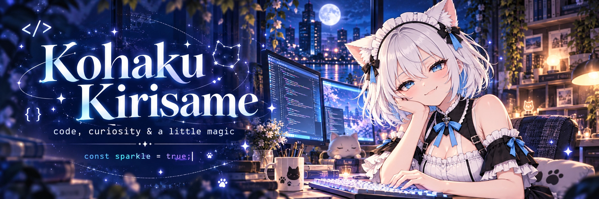
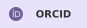
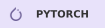
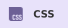
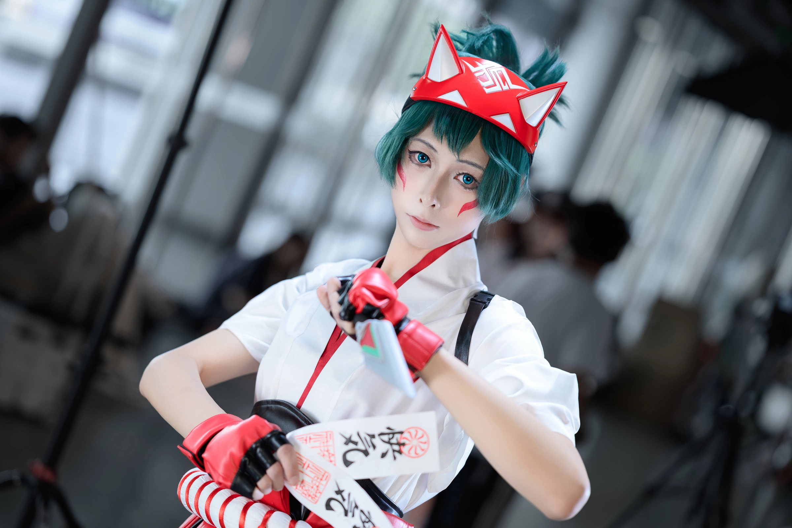
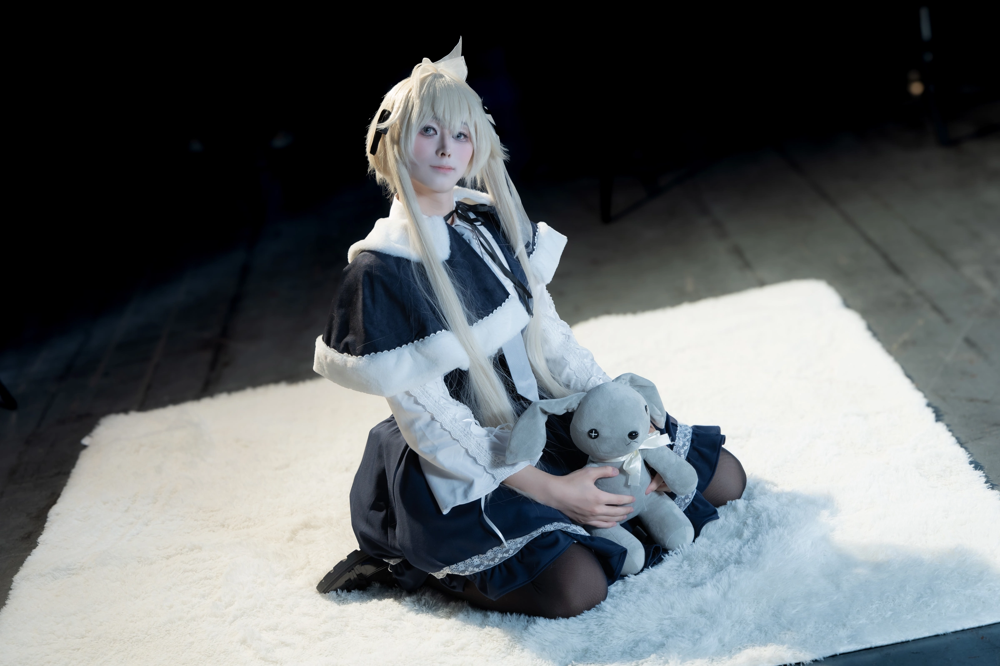

<!-- Profile artwork and customization notes: docs/CUSTOMIZE.md -->

  

<h1 align="center">✧ Welcome to my little universe ✧</h1>

  <b>Code, curiosity &amp; a little magic.</b> 
  写一点代码，做一点研究，收集一些闪闪发光的瞬间。

  

  
  
  

  <a href="#about">About</a> ·
  <a href="#toolbox">Toolbox</a> ·
  <a href="#projects">Projects</a> ·
  <a href="#cosplay">Cosplay</a>

<h2 align="center">☾ A little about me</h2>

  Hi, I'm <b>Kohaku</b>  I make research tools, web apps, and little things with personality. 
  Somewhere between neural signals, a new side project, and the next character to bring to life.

  🧠 <b>Neural signals &amp; machine learning</b> 
  🛠️ <b>Useful tools &amp; creative coding</b> 
  🎀 <b>Touhou, cosplay &amp; a little kirakira</b>

<i>好奇心常驻，幻想永不下线。</i>

  📺 <b>Indie VTuber · 个人势 VTB</b> 
  <a href="https://live.bilibili.com/4949702">Bilibili Live · 直播间 4949702 ↗</a>

<h2 align="center">⌘ My little toolbox</h2>

  
  
  
  
  
  
  
  
  
  
  

<h2 align="center">✦ Things I've been making</h2>

A few little worlds, built one commit at a time.

<table>
  <tr>
    <td width="50%" valign="top">
      <h3>🧠 <a href="https://github.com/IgarashiAkatuki/HuiduRep">HuiduRep</a></h3>
      
Self-supervised representation learning for extracellular recordings, with a pipeline for spike sorting.

      
NEUROSCIENCE · PYTHON · PYTORCH

    </td>
    <td width="50%" valign="top">
      <h3>⚡ <a href="https://github.com/IgarashiAkatuki/VanillaSort">VanillaSort</a></h3>
      
A pretrained spike sorting pipeline, with a Python package and a SpikeInterface-compatible API.

      
SPIKE SORTING · PYTHON · PYTORCH

    </td>
  </tr>
  <tr>
    <td width="50%" valign="top">
      <h3>🌙 <a href="https://github.com/KohakuKirisame/LunarDial">LunarDial</a></h3>
      
A Touhou-inspired desktop calendar. A small tribute to Sakuya and the passing of time.

      
PYTHON · PYSIDE6 · TOUHOU

    </td>
    <td width="50%" valign="top">
      <h3>🍋 <a href="https://github.com/IgarashiAkatuki/CNMBERT">CNMBert</a></h3>
      
A BERT-based model for converting Hanyu Pinyin abbreviations and Chinese homophones into characters.

      
NLP · BERT · CHINESE

    </td>
  </tr>
</table>

<a href="https://github.com/KohakuKirisame?tab=repositories">Explore the rest of my little universe ↗</a>

<h2 align="center">♡ Beyond the keyboard</h2>

  <b>A different kind of character building.</b> 
  把喜欢的角色，带到现实里。 ✧ Cosplay gallery ✧

<!-- COSPLAY GALLERY: optimized WebP photos only. -->
<table>
  <tr>
    <td width="50%" align="center" valign="top">
      
      
<b>✧ Kamori Kiriko ✧</b>

    </td>
    <td width="50%" align="center" valign="top">
      
      
<b>✧ Kasugano Sora ✧</b>

    </td>
  </tr>
</table>

  ☾ Made of curiosity, code &amp; stardust · <a href="https://kohaku.icu">Come say hello</a> ☽

<!-- Monster Hunter: World blessing. Wording and sources: docs/quote-sources.md -->

  ✦ <b>愿指引明路的苍蓝星为你们闪耀！</b> ✦ 
  <i>May the Sapphire Star light your way!</i> 
  君達に導きの青い星が輝かんことを！

